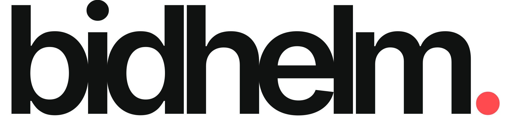

<p></p>

Self-hosted DSP for buying popunder traffic with your own campaigns.
Create traffic sources, set targeting and CPM bids, and apply changes without restarting the bidder.

The first release supports **EXADS JSON Pop**, country/device/browser/OS targeting, IP and CIDR filters, placement blocklists and allowlists, and placement macros for tracker URLs.

## Install

You need a fresh **Ubuntu 24.04 or Debian 12/13 server, x86_64**, root access, and an available TCP port. Docker is installed automatically if needed. ARM servers are not supported by this release.

If `curl` is unavailable, install it with `sudo apt-get update && sudo apt-get install -y curl`.

Download the installer for **0.1.0**, then run it:

```sh
curl -fsSLo bidhelm-bootstrap.sh https://raw.githubusercontent.com/xblxnn/bidhelm/v0.1.0/scripts/bootstrap.sh
sudo bash bidhelm-bootstrap.sh
```

Enter an administrator login when prompted. The installer prints the backoffice URL and a generated password. Open that URL and sign in. Initial credentials are also stored in `/opt/bidhelm/initial-access.txt`, readable only by root.

No GitHub account or registry token is required. The application runs in the `bidhelm` Docker container; data stays in `/opt/bidhelm/data`. Running the installer again preserves your installation and credentials.

To use a different port:

```sh
sudo env DSP_PORT=18080 bash bidhelm-bootstrap.sh
```

Optional settings: `DSP_IP` for the advertised hostname/IP, `DSP_BIND_IP` for the host IPv4 binding, `DSP_HOME` for an absolute data location, and `MMDB_FILE` for your own country MMDB. Default: all IPv4 interfaces, port 80, `/opt/bidhelm`.

The default URL uses HTTP. For Internet-facing administration, use an HTTPS reverse proxy and restrict access appropriately; see [operations](docs/operations.md).

## First campaign

1. Create a traffic source and copy its `/source/{id}` URL to your SSP.
2. Create a campaign with an HTTPS destination URL, CPM in USD, and your targeting.
3. Activate it and wait for **DSP ready** with matching saved/applied revisions.

Only the most specific matching campaigns compete on price. A valid request without a matching active campaign receives HTTP 204. See the [EXADS integration](docs/exads.md) for request and response examples.

## Update

Updates are manual. Choose a published version, download its update script, and set the matching image:

```sh
curl -fsSLo bidhelm-update.sh https://raw.githubusercontent.com/xblxnn/bidhelm/v0.1.0/scripts/update.sh
sudo env DSP_IMAGE=ghcr.io/xblxnn/bidhelm:0.1.0 bash bidhelm-update.sh
```

For a future release, replace **both** version values. The updater preserves data and networking and creates a SQLite backup before replacing the container. Read [backup and restore](docs/operations.md#restore) before upgrading. Publishing a new release never updates an installed server automatically.

## Country database

Includes [DB-IP Country Lite](https://db-ip.com/db/download/ip-to-country-lite), November 2026, under [CC BY 4.0](https://creativecommons.org/licenses/by/4.0/). IP Geolocation by [DB-IP](https://db-ip.com). This free database has reduced coverage and accuracy. You can supply a compatible MMDB with `country.iso_code`; database updates are manual.

## Development

With Go 1.26.10, Bash and OpenSSL installed:

```sh
./scripts/dev.sh
```

Open the local URL printed by the script. Local data and credentials stay in the ignored `data/` directory. Run `go test -race ./...` and `go vet ./...` to check the code.

## License

All rights reserved. See [LICENSE](LICENSE) for permitted self-hosted use and [third-party notices](THIRD_PARTY_NOTICES.md) for dependencies and data.
